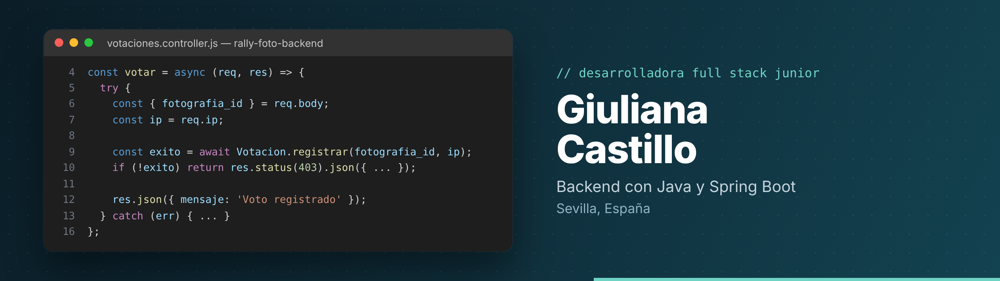
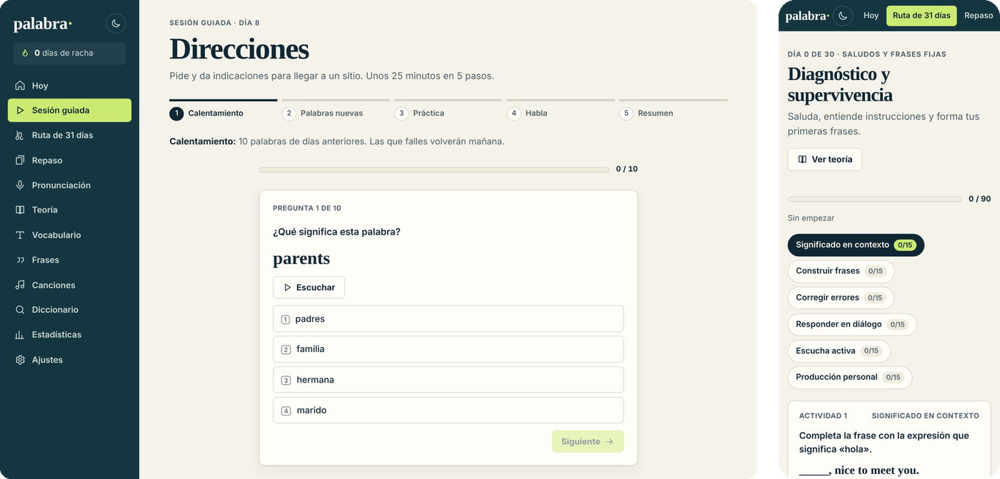
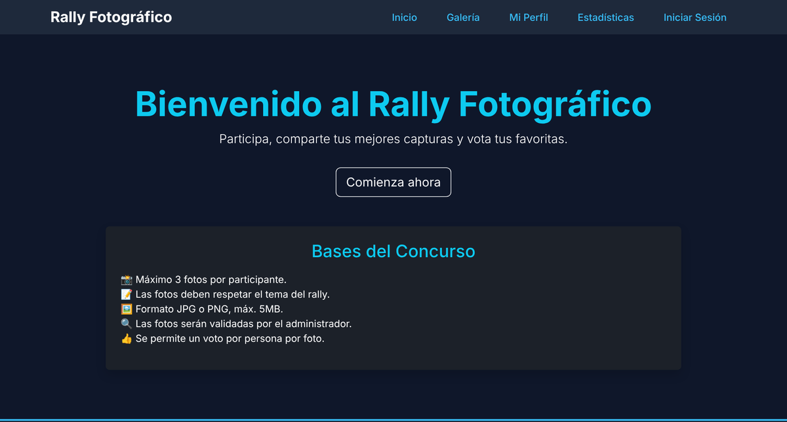

Hola, soy Giuliana. Estudié DAM y luego DAW, y hice prácticas en **Quantum** (Java, Spring Boot y APIs REST, donde acabé coordinando un proyecto de gamificación) y en **Grupo Oro** (PHP y Laravel).

Lo que más me gusta es el backend: pensar bien los datos, que la API sea segura y que el código se pueda mantener. Pero me gusta terminar las cosas, así que también me peleo con el frontend y con el despliegue.

Ahora mismo busco mi primer puesto como desarrolladora junior, en remoto o en Sevilla.

 

## Palabra

**App web para aprender inglés en 31 días.** Sesión diaria de unos 25 minutos, repaso espaciado (lo que fallas vuelve antes), ejercicios de pronunciación con reconocimiento de voz que marcan palabra a palabra lo que no se ha entendido, y estadísticas de progreso. Funciona sin servidor ni registro y se instala como app en el móvil.

El detalle del que más orgullosa estoy: en un Windows en español sin voces en inglés, el navegador leía las frases en inglés con la voz española. Ahora Palabra solo usa voces inglesas y, si no hay ninguna, desactiva el audio y te explica cómo instalar una.

`React` `TypeScript` `Zustand` `Vitest (154 tests)` `GitHub Actions` · [Probarla](https://giuliana2002.github.io/Palabra/) · [Código](https://github.com/giuliana2002/Palabra)

 

## Rally fotográfico

**Plataforma para organizar concursos de fotografía.** Proyecto final de DAW. Registro e inicio de sesión con JWT y roles, subida de fotos a Cloudinary, votación pública limitada a un voto por persona y panel de administración para validar fotos, gestionar participantes y crear rallys. Lo desplegué yo misma en un servidor de DigitalOcean.

> *"25 de mayo: implementé la parte de admin, pero lo de validar las fotos ha costado. Se solucionó y ya tengo una aplicación decente."*
> Fragmento de mi [diario de desarrollo](https://github.com/giuliana2002/frontend-rally/blob/main/DIARIO.md)

`Node.js` `Express` `MySQL` `JWT` `Cloudinary` `Bootstrap` · [Backend](https://github.com/giuliana2002/rally-foto-backend) · [Frontend](https://github.com/giuliana2002/frontend-rally)

 

## SaaS de pedidos por QR

**Mi proyecto actual.** Los clientes de un bar piden desde la mesa escaneando un QR, el camarero tiene su panel y la cocina ve qué está pendiente, en preparación o listo. Cada bar solo accede a sus datos y los permisos se validan en el servidor. El repositorio es privado.

`Java` `Spring Boot` `Spring Security` `PostgreSQL` `Flyway` `JUnit` `React` `TypeScript`

 

## Con lo que trabajo

  
  
  
  
  
  
  
  
  
  
  
  
  

Últimamente estoy aprendiendo a montar agentes de IA y a usar LLMs en local con Ollama, y a meter IA en backends Java con Spring AI. Iré subiendo aquí lo que salga.

 

**Contacto:** [LinkedIn](https://www.linkedin.com/in/giuliana-castillo) · [Portfolio](https://giulianacastillo.vercel.app) · giuliana2015gc@gmail.com
